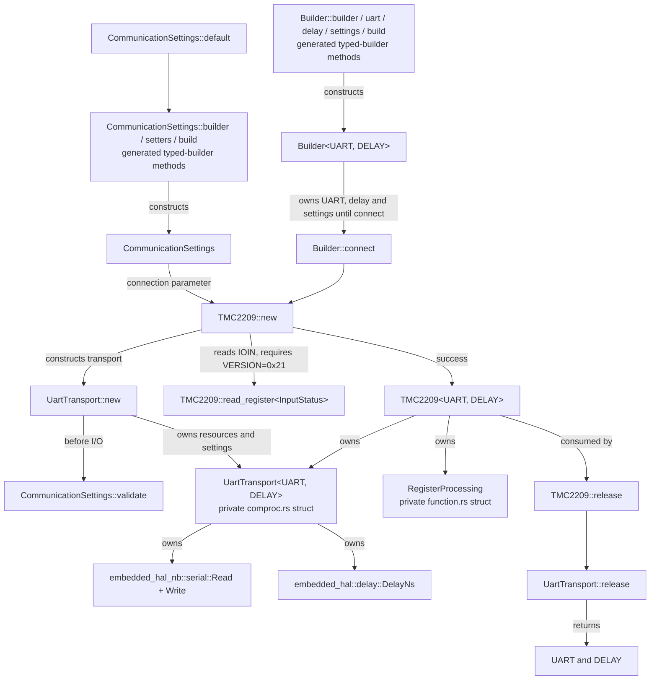
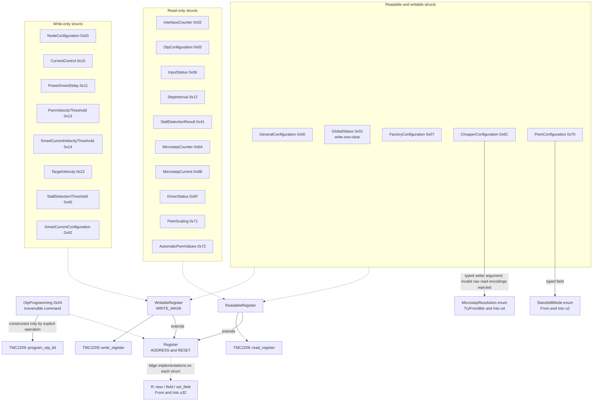
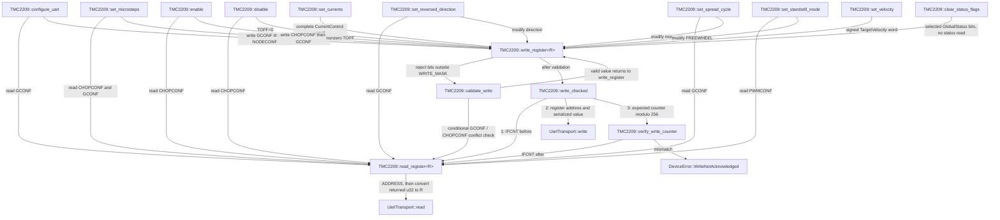
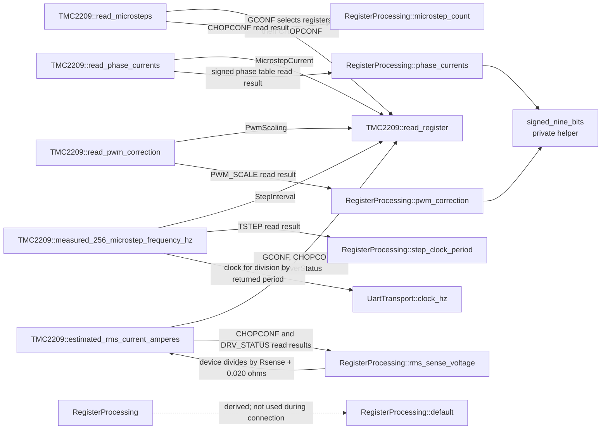
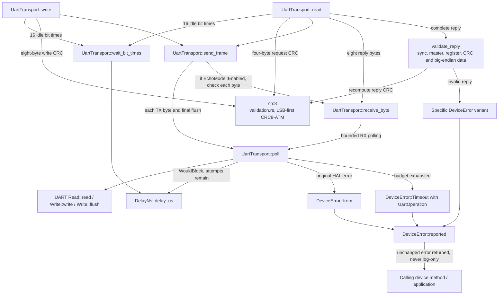
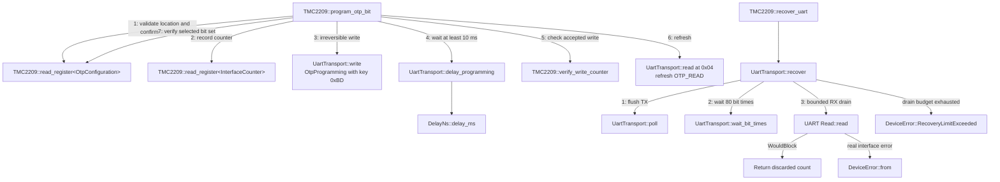

# TMC2209

Allocation-free, `no_std`, blocking UART driver for the TMC2209. It uses
`embedded-hal` 1.0 `DelayNs`, `embedded-hal-nb` 1.0 serial `Read`/`Write`, bilge
register types, bounded polling, reply/CRC validation, echoed/non-echoed UART
topologies and IFCNT-verified writes. Optional `defmt` logging supplements error
returns. All 24 documented registers are typed; access traits distinguish
readable and writable words. GSTAT is write-one-clear; OTP uses a separate,
explicit programming operation.

This completes the pre-existing `TMC2209/` scaffold, retaining its module path
and adding a root `TMC2209` export. The former argument-free constructor,
empty methods and error-discarding enable-pin placeholder are replaced by real
resource-owning methods. Hardware ENN and STEP/DIR pins remain application-owned.

## Connect without starting the motor

```rust
use embedded_hal::delay::DelayNs;
use embedded_hal_nb::serial::{Read, Write};
use tmc2209::{
    builder::Builder, CommunicationSettings, DeviceError, MicrostepResolution,
    register::DriverStatus, u2, u4, u5,
};

fn configure<U: Read<u8> + Write<u8>, D: DelayNs>(
    uart: U,
    delay: D,
) -> Result<(), DeviceError<U::Error>> {
    // Application keeps hardware ENN high and STEP inactive during configuration.
    let settings = CommunicationSettings::builder()
        .address(u2::new(0))
        .build();
    let mut device = Builder::builder()
        .uart(uart)
        .delay(delay)
        .settings(settings)
        .build()
        .connect()?;
    device.configure_uart(u4::new(2))?;
    device.set_currents(u5::new(8), u5::new(16), u4::new(2))?;
    device.set_microsteps(MicrostepResolution::Microsteps16)?;
    let _status = device.read_register::<DriverStatus>()?;
    let (_uart, _delay) = device.release();
    Ok(())
}
```

The default echo mode matches the shared TX/RX resistor circuit. Use
`CommunicationSettings::builder().echo(EchoMode::Disabled)` only when the
application's configured UART/adapter suppresses TX echo. Configure UART hardware
to the same baud as settings; the driver cannot change peripheral registers.

## Typed register access

```rust
use embedded_hal::delay::DelayNs;
use embedded_hal_nb::serial::{Read, Write};
use tmc2209::{DeviceError, TMC2209, register::PwmConfiguration};

fn configure_pwm<U: Read<u8> + Write<u8>, D: DelayNs>(
    device: &mut TMC2209<U, D>,
) -> Result<(), DeviceError<U::Error>> {
    let mut configuration = device.read_register::<PwmConfiguration>()?;
    configuration.set_automatic_amplitude(true);
    device.write_register(configuration)?;
    Ok(())
}
```

Write-only registers such as `CurrentControl` cannot be read, and must be
provided as complete values. The device holds no fabricated register shadows.
GSTAT acknowledgement writes only requested bits; it is not read-modify-write.
Reserved bits, TEST_MODE, invalid microstep/off-time/hysteresis settings and
incompatible double-edge/filter configuration are rejected.

**Motion is explicit:** `enable` can energize the motor and `set_velocity` can
start the pulse generator. `disable` turns bridges off but does not clear
VACTUAL. VACTUAL=0 selects external STEP/DIR; it does not stop external STEP
pulses. Never rely on releasing/dropping the object to stop hardware.

## Errors and recovery

Every fallible method returns `DeviceError<U::Error>`. `Interface(error)` owns
the original UART error, including non-`Copy` payloads; it is never replaced by
`ErrorKind`, a boolean result, or logging-only handling.

Specific variants distinguish polling timeout (TX/RX/flush), echo mismatch,
bad sync/master/register/CRC, unsupported silicon version, missing write
acknowledgement, invalid settings/register fields, unavailable measurements,
unsupported current estimation, and OTP verification failures.

There are no automatic read/write retries or silent defaults. After an
incomplete exchange, call `recover_uart` with exclusive bus ownership, then
reconcile any uncertain write before retrying. A later error in a multi-step
operation does not undo earlier writes. A failed constructor consumes resources;
borrow/shared-own the UART if it must be recovered outside the constructor.

## Hardware and scope

- Follow the manufacturer's PDN_UART resistor/buffer circuit, voltage/current,
  clock, grounding and supply requirements. A UART adapter with automatic
  half-duplex direction must release TX after the final stop bit.
- Hold ENN disabled during configuration. The **chip's** default state may
  energize a connected motor if ENN is low, even though connection is read-only.
- Use address pins 0-3 and SENDDELAY>=2 on shared buses. Exclusively lock the
  physical UART for complete driver operations, including counter verification.
- Defaults assume 115200 baud and a 12 MHz device clock. Clock trim or an
  external clock changes frequency/current-control timing assumptions; reconnect
  with matching settings after calibration. Baud must be >=9000 and <=fCLK/16.
- Polling is bounded per byte/flush, not a hard real-time guarantee against a
  blocking HAL or scheduler stalls. See PROCEDURE.md for the timing budget.
- Current estimation supports external Rsense with analog scaling disabled;
  signed phase table values are not measured amperes. Respect sense/motor/board
  limits independently of a nominal calculated current.
- OTP programming is irreversible, explicit and not performed by ordinary
  writes or setup. Read the manufacturer programming procedure before calling it.
- This is the TMC2209 UART device driver, not a TMC2208/TMC2225 driver, motion
  planner, async UART adapter or automatic motor-tuning controller.

See [REGISTERS.md](REGISTERS.md), [FUNCTIONS.md](FUNCTIONS.md) and
[PROCEDURE.md](PROCEDURE.md) for every field, read requirement, equation and
communication/programming procedure.

## Struct and function connections

These diagrams cover every library struct and handwritten function, including
private helpers. Bilge field constructors/getters/setters and typed-builder
methods are grouped; compiler-derived formatting/equality/copying and test-only
helpers are omitted. Arrows identify ownership, calls or passed values as labeled.

### Ownership, construction and release



### All 24 register structs and access permissions

Every register is a bilge 32-bit struct with `R::new`, field getters/setters,
`R::from(u32)` and `u32::from(R)` / `R::into`. Generated setters only change a
local value, not hardware access rights. The sealed `Register` trait supplies
address/reset metadata; read/write traits gate the device methods.



### Configuration methods and verified writes

Setter edge labels name the affected register. `validate_write` may read the
other configuration register to reject double-edge/filter conflicts. Every
actual write is checked against IFCNT; returning an error does not roll back
an already-transmitted write.



### Register-result processing and physical quantities

Device methods perform reads before invoking the pure `RegisterProcessing`
methods. User-supplied resistance and the configured clock never enter those
pure functions.



### UART framing, validation and error forwarding



### Explicit OTP programming and UART recovery

Numbered OTP edges show order; every fallible step propagates its error without
retrying. Recovery deliberately discards RX data, not errors, and reports how
many bytes were discarded.



## Validation

```text
cargo test --manifest-path TMC2209/Cargo.toml --no-default-features
cargo test --manifest-path TMC2209/Cargo.toml --all-features
cargo clippy --manifest-path TMC2209/Cargo.toml --all-targets --all-features -- -D warnings
cargo fmt --manifest-path TMC2209/Cargo.toml -- --check
cargo build --manifest-path TMC2209/Cargo.toml --lib --target thumbv7em-none-eabi --all-features
```

Install the desired bare-metal Rust target if missing. Host mocks check UART
framing, echo, bounded polling, error forwarding, counter rollover and typed
device operations. CRC and all pure processing functions have focused tests.
**No physical hardware or OTP programming validation has been performed.**

## References

- Primary source: [bundled manufacturer datasheet, rev. 1.09 (2023-02-16)](documentation/TMC2209_datasheet_rev1.09.pdf).
  The manufacturer download endpoint was unreachable during implementation;
  the availability of newer revisions/errata could not be verified.
- [Janelia Arduino TMC2209](https://github.com/janelia-arduino/TMC2209) and
  [its implementation](https://github.com/janelia-arduino/TMC2209/blob/main/src/TMC2209/TMC2209.cpp)
  consulted as reference only. This Rust implementation is independent and does
  not reproduce its cached-register/unidirectional-write behavior.
- [Bundled SilentStepStick board datasheet](documentation/tmc2209_silentstepstick_datasheet_rev1.20.pdf)
  is board-specific; do not assume its pinout/layout applies to every carrier.
