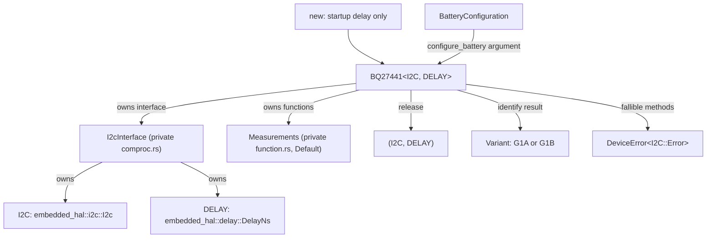
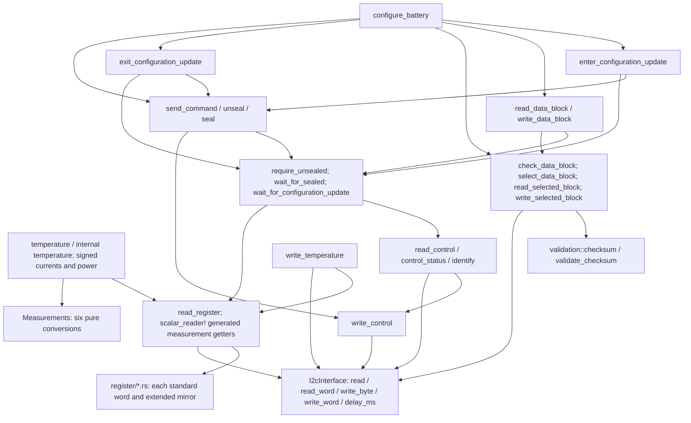
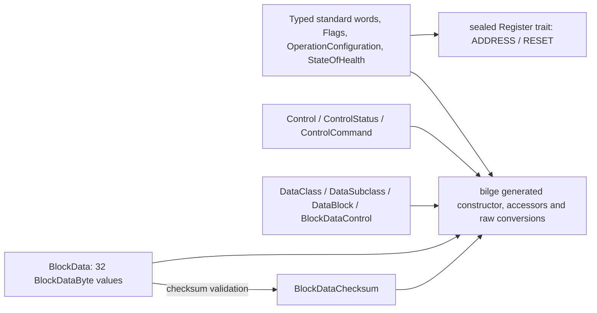

# BQ27441-G1

Allocation-free, `no_std`, blocking `embedded-hal` 1.0 I2C driver for TI's
BQ27441-G1A and BQ27441-G1B single-cell fuel gauges. Bilge-typed registers and
optional `defmt` diagnostics. See [REGISTERS.md](REGISTERS.md) for the complete
command and data-memory map.

## Usage

```rust
use bq27441::{BQ27441, DeviceError};
use embedded_hal::{delay::DelayNs, i2c::I2c};

fn example<I: I2c, D: DelayNs>(i2c: I, delay: D) -> Result<(), DeviceError<I::Error>> {
    let mut gauge = BQ27441::new(i2c, delay);
    let variant = gauge.identify()?;
    let flags = gauge.flags()?;
    // Application must ensure BAT_DET and INITCOMP before trusting predictions.
    let voltage_mv = gauge.voltage_millivolts()?;
    let current_ma = gauge.average_current_milliamps()?;
    let temperature_centicelsius = gauge.temperature_centicelsius()?;
    let charge_percent = gauge.state_of_charge_percent()?;
    let health = gauge.state_of_health()?;
    // Use health.percent() only when health.status() indicates a valid estimate.
    let (i2c, delay) = gauge.release();
    Ok(())
}
```

Configure the I2C controller for at most **400 kHz**, with clock stretching.
Only I2C is supported by this part, so there is no protocol-selecting builder
or SPI implementation. The driver is blocking, like the reference
`mcp23017` crate; it does not depend on the async HAL, bus helpers, a builder,
or `libm` unnecessarily. A compatible `embedded-hal-bus` handle can be supplied
by applications sharing a physical controller. The fixed address is 0x55.

### Cell configuration

```rust
use bq27441::{BQ27441, BatteryConfiguration, DeviceError};
use embedded_hal::{delay::DelayNs, i2c::I2c};

fn configure<I: I2c, D: DelayNs>(
    gauge: &mut BQ27441<I, D>,
) -> Result<(), DeviceError<I::Error>> {
    gauge.configure_battery(BatteryConfiguration {
        design_capacity_milliamp_hours: 1200,
        design_energy_milliwatt_hours: 4440, // 1200 mAh * 3.7 V
        terminate_voltage_millivolts: 3200,
        taper_rate: 100, // 10 * 1200 mAh / 120 mA
    })
}
```

Choose parameters for the actual cell and charger; the example is not a
universal battery profile. Configuration unseals only when needed, enters
CONFIG UPDATE, preserves neighboring/reserved bytes, commits and verifies the
full page, exits by SOFT_RESET and restores the original seal state. When a
previously unsealed gauge auto-reseals on soft reset, it is unsealed again.
For production, explicitly call `seal()` after setup if it was initially
unsealed. The fixed ROM unseal key is not a configurable security credential.

### Typed register and low-level data-memory access

```rust
use bq27441::{
    BQ27441, DeviceError,
    register::{DataBlock, DataSubclass, Voltage},
};
use embedded_hal::{delay::DelayNs, i2c::I2c};

fn inspect<I: I2c, D: DelayNs>(
    gauge: &mut BQ27441<I, D>,
) -> Result<(), DeviceError<I::Error>> {
    let voltage: Voltage = gauge.read_register()?;
    gauge.unseal()?;
    let state = gauge.read_data_block(DataSubclass::State, DataBlock::from(0))?;
    gauge.seal()?;
    Ok(())
}
```

Every standard register and extended command is typed under `register/`.
`Control` and byte/block selectors are deliberately excluded from the generic
word-read trait. Use `read_control` for queries and `send_command` for actions.
There is no arbitrary word-write API. Host temperature writes check TEMPS.
Raw data-block writes require unsealed CONFIG UPDATE, valid page indices and
non-ROM subclasses; callers remain responsible for parameter ranges, reserved
bytes and fields crossing page boundaries. Health status preserves reserved
codes instead of pretending an unknown status is valid.

## Timing, startup and recovery

- `new` waits 250 ms for communication power-up but performs no bus I/O,
  resets, identity checks, battery-insertion commands or implicit configuration.
  Use `identify` for variant checks and `control_status().initialization_complete()`
  plus `flags().battery_detected()` before trusting gauging predictions.
- Configuration is volatile RAM. POR, SHUTDOWN and full RESET can discard it.
  Check ITPOR and reload cell parameters after reset. SOFT_RESET clears ITPOR
  and CFGUPMODE without restoring ROM defaults.
- Default BIE uses the BIN pin. If BIE is deliberately disabled through data
  memory, send BatteryInsert/BatteryRemove yourself. Hibernate is a request,
  not an immediate power-down. SHUTDOWN requires unsealed state and prior
  EnableShutdown; wake-up requires externally driving GPOUT high for at least
  200 us. The driver does not own a GPOUT pin.
- All packets are followed by at least 66 us, even on interface errors.
  Writes always use one data byte per packet, satisfying TI's >100 kHz rule.
  Standard reads add 500 ms, and Control/Temperature word writes add 2 s.
  This conservative pacing meets the datasheet's standard-command rate and
  read/write update restrictions at the cost of substantial latency.
  Configuration and identity queries can therefore take many seconds.
  No asynchronous operation, busy-loop polling or automatic retry is hidden.
- Software delays must not be shortened by an inaccurate `DelayNs`
  implementation. Commands cannot be driven by another handle while this
  driver is in use. Pacing also applies when retrying a failed standard word.
- Sharing the physical bus with **other chips** is supported through a
  compatible shared-bus I2C handle. Sharing the same logical gauge is not:
  Control response selection, key sequences and data-memory selectors span
  separate I2C transactions. Per-transaction locks do not protect them.
- Operations are **not atomic**. Failure can leave only a low command byte
  written, one unseal word accepted, partial block staging, committed RAM whose
  readback failed, CONFIG UPDATE still active, or sealing already changed.
  Errors stop immediately and preserve the original HAL payload. There is no
  best-effort cleanup that could obscure the primary error. After failure,
  inspect control status and flags, explicitly restore mode/sealing, reselect
  and checksum-verify affected pages, or reset/reconfigure as appropriate.
  Do not assume a failed call means no hardware changes occurred.

## Struct ownership and function connections

Generated methods are grouped below: each bilge word/byte type has typed
`new`, field getters/setters, raw `From`/`Into`, copy/equality and debug methods.
ControlCommand and DataSubclass have checked raw conversions; HealthStatus
preserves unknown raw values. None of these generated setters performs I/O.







## Errors and validation

`DeviceError::Interface(error)` preserves the original HAL error, not just its
ErrorKind. Other variants distinguish unexpected identity, sealed access,
invalid control-query/action direction, missing shutdown enable, missing
CONFIG UPDATE, mode/sealing timeout, disabled external temperature, each
invalid battery parameter, invalid page, ROM writes, checksum mismatch and
full-page verification failure. Checksum errors include expected/received
bytes; timeouts include the requested state. Optional `defmt` logs supplement
error returns and require no `Format` bound on the HAL error.

Run from the repository root:

```text
cargo fmt --manifest-path bq27441/Cargo.toml --check
cargo test --manifest-path bq27441/Cargo.toml --no-default-features
cargo test --manifest-path bq27441/Cargo.toml --all-features
cargo clippy --manifest-path bq27441/Cargo.toml --all-targets --no-default-features -- -D warnings
cargo clippy --manifest-path bq27441/Cargo.toml --all-targets --all-features -- -D warnings
cargo doc --manifest-path bq27441/Cargo.toml --no-deps --no-default-features
cargo doc --manifest-path bq27441/Cargo.toml --no-deps --all-features
cargo build --manifest-path bq27441/Cargo.toml --target thumbv7em-none-eabi --no-default-features
cargo build --manifest-path bq27441/Cargo.toml --target thumbv7em-none-eabi --all-features
```

Tests cover actual bus framing, byte order, command pacing, signed/temperature
conversion, both variants, health validity, OpConfig bit positions, configuration
range boundaries, mode timeouts, checksum/readback failures, neighboring-byte
preservation, auto-resealing and error injection at every transfer in all three
configuration/sealing paths. A separate HAL implementation verifies custom
error payload preservation. **No physical hardware has been tested.**

Validation on 2026-10-23 passed all commands above: 22 unit/integration tests
and 4 doctests in each feature configuration, warning-free Clippy and rustdoc,
and `thumbv7em-none-eabi` builds with and without `defmt`.

See [FUNCTIONS.md](FUNCTIONS.md) for method sequences and equations.

## References

- TI [BQ27441-G1 product page](https://www.ti.com/product/BQ27441-G1), including
  the current documentation list (checked 2026-10-23; no separate errata listed).
- [Datasheet SLUSBH1C](https://www.ti.com/lit/ds/symlink/bq27441-g1.pdf),
  revised December 2014.
- [Technical Reference Manual SLUUAC9A](https://www.ti.com/lit/ug/sluuac9a/sluuac9a.pdf),
  revised May 2015.
- Existing Rust [`bq27441`](https://docs.rs/bq27441/latest/bq27441/) consulted
  for API comparison only; implementation follows the TI specifications.

G1A is for 4.2 V LiCoO2 cells (CHEM_ID 0x0128, DM_CODE 0x48).
G1B is for 4.3/4.35 V cells (CHEM_ID 0x0312, DM_CODE 0x58).
Both report DEVICE_TYPE 0x0421; that identifier alone is not variant detection.
Chemistry profiles are fixed in ROM and cannot be changed by configuration.
