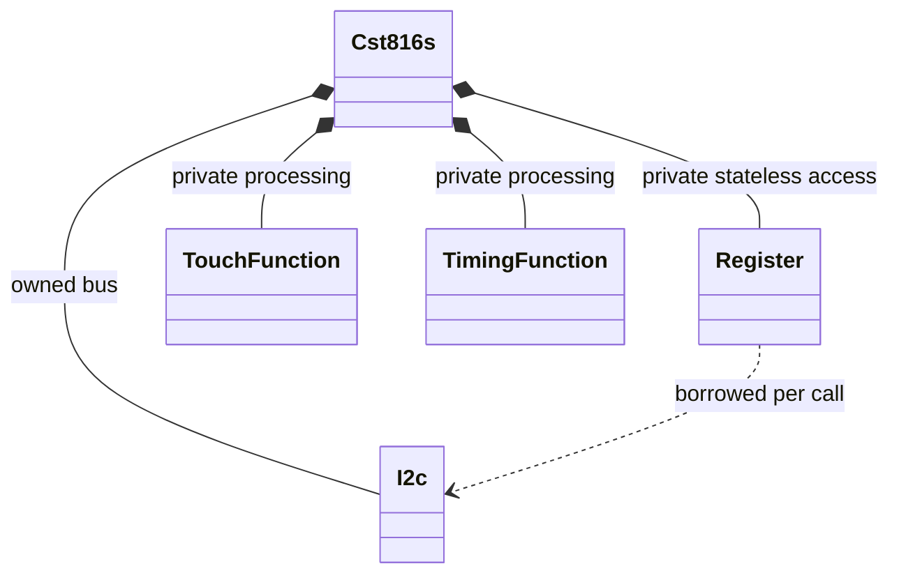
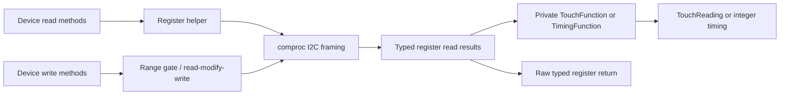

# CST816S

`cst816` is a synchronous `no_std`, embedded-hal 1.0 I2C driver for **CST816S**.
Other CST816 variants (including CST816D/T) are **not verified**. Registers use
bilge typed fields; optional `defmt` supports register/result/error formatting.
No async, builder, floating-point math or additional dependencies are needed.

See [REGISTERS.md](REGISTERS.md) for all 32 declared byte registers and their
known/unknown contracts, and [FUNCTIONS.md](FUNCTIONS.md) for derived processing.

```rust
use cst816::{Cst816s, Cst816sError, TouchReading, register::InterruptPulseWidth};
use embedded_hal::i2c::I2c;

fn touch<I: I2c>(i2c: I) -> Result<(I, TouchReading), Cst816sError<I::Error>> {
    let mut device = Cst816s::new(i2c); // ready, powered device; no constructor I/O
    device.write_interrupt_pulse_width(InterruptPulseWidth::default())?;
    let reading = device.read_touch()?;
    Ok((device.release(), reading))
}
```

## Migration

- Use `Cst816s` instead of `Cst816x`. The old root and `device::` spellings are
  deprecated aliases, not promises of family-wide compatibility.
- `with_address(i2c, address)` now returns
  `Result<Cst816s<I>, Cst816sAddressError<I>>`. Invalid `0x80..=0xFF` returns the
  supplied address and **owned untouched bus** in `error.address` / `error.i2c`.
  No address is clamped/shifted. All `0x00..=0x7F` destinations pass seven-bit
  format validation; reserved bus addresses need application-level policy.
  `new(i2c)` still uses `0x15`, corroborated by independent implementations.
  A custom destination does not reprogram the controller's hardware address.
- Canonical paths are `register` / `src/register.rs` / `src/register/`;
  `registers` is an unchanged compatibility re-export of the same types.
- Out-of-range numeric configuration writes now return
  `Cst816sError::InvalidRegisterValue { address, value }` **before any I2C**.
  Raw bilge `From<u8>` reads remain lossless, including out-of-range values.
- Removed `write_bpc0`, `write_bpc1`, `write_low_power_scan_raw1`,
  `write_low_power_scan_raw2`: no authoritative writable/calibration contract
  was found. Combined reads and typed byte/pair definitions remain available.
- X/Y methods now use a two-byte sequential read, rather than two single-byte
  transactions. `read_touch()` reads the complete six-byte touch window.
  Update exact bus mocks to expect these lengths.

```rust
use cst816::{Cst816s, Cst816sAddressError};
use embedded_hal::i2c::I2c;

fn custom<I: I2c>(bus: I, address: u8) -> Result<I, Cst816sAddressError<I>> {
    Cst816s::with_address(bus, address).map(Cst816s::release)
}
```

Unsupported reference writes are deliberately absent:

```compile_fail
use cst816::{Cst816s, register::Bpc0};
fn unsupported<I: embedded_hal::i2c::I2c>(d: &mut Cst816s<I>) {
    d.write_bpc0(Bpc0::from(0x1234));
}
```
```compile_fail
use cst816::{Cst816s, register::Bpc1};
fn unsupported<I: embedded_hal::i2c::I2c>(d: &mut Cst816s<I>) {
    d.write_bpc1(Bpc1::from(0x1234));
}
```
```compile_fail
use cst816::{Cst816s, register::LowPowerScanRaw1};
fn unsupported<I: embedded_hal::i2c::I2c>(d: &mut Cst816s<I>) {
    d.write_low_power_scan_raw1(LowPowerScanRaw1::from(0x1234));
}
```
```compile_fail
use cst816::{Cst816s, register::LowPowerScanRaw2};
fn unsupported<I: embedded_hal::i2c::I2c>(d: &mut Cst816s<I>) {
    d.write_low_power_scan_raw2(LowPowerScanRaw2::from(0x1234));
}
```

## Device method groups

Methods are explicit, not macro-generated. Prefixes denote separate methods;
all addresses in the declaration are covered by reads, not a read-all snapshot.

| Group | Methods / suffixes | Access |
|-------|--------------------|--------|
| Touch | `read_touch`; `gesture_identifier`, `finger_number`, `x_position`, `y_position` | Read |
| Identity | `chip_identifier`, `project_identifier`, `firmware_version` | Read |
| Unverified BPC/reference values | `bpc0`, `bpc1`, `low_power_scan_raw1`, `low_power_scan_raw2` | Read only |
| Gesture configuration | `motion_mask`, `motion_sliding_angle` | Read/write |
| Interrupt configuration | `interrupt_pulse_width`, `interrupt_control` | Read/write; IRQ mapping provisional |
| Scan configuration | `normal_scan_period`, `low_power_auto_wake_time`, `low_power_scan_threshold`, `low_power_scan_window`, `low_power_scan_frequency`, `low_power_scan_current` | Read/write with numeric bounds |
| Power/reset/I/O | `auto_sleep_time`, `auto_reset`, `long_press_time`, `io_control`, `auto_sleep_disable` | Read/write; device-wide effects |
| Derived timing | `read_interrupt_pulse_width_microseconds`, `read_normal_scan_period_milliseconds`, `read_low_power_auto_wake_time_seconds` | Read, integer conversion |
| Ownership | `new`, `with_address`, `release` | No I/O |

Only the documented seven constrained settings are range-checked; no additional
range is invented for other full-byte settings. Gesture and finger counts use
fallible typed decoding; undocumented codes are explicit errors.

## Touch consistency

`read_touch()` issues one embedded-hal `write_read(address, &[0x01], six_bytes)`:
START, slave+W, pointer, repeated START, slave+R, six sequential bytes, STOP.
It decodes gesture, whole finger-count byte, X high/low and Y high/low.
Coordinates are 12-bit controller units, without screen bounds/rotation/scaling.
High nibbles are excluded from coordinates, not interpreted as undocumented
event flags. Finger count 0 yields `position: None` (not `(0,0)`); stale
coordinates are suppressed but the decoded gesture is retained. Count 1 yields
`Some(TouchPosition)`. Other counts or unknown gestures are rejected.

InfiniTime's `GetTouchInfo` and `TwiMaster::Read` corroborate six-byte sequential
addressing and no STOP between pointer write/read. Felix Biego's driver separately
corroborates the six-byte window, but uses a STOP between phases; it is not
evidence for repeated-start framing. The manufacturer sources found describe
standard I2C, **not sequential addressing or sample latching**. This driver uses
the independently demonstrated touch-window framing, not a claimed manufacturer
burst guarantee; it does not generalize bursts to unknown calibration addresses.

**No source found guarantees that IRQ freezes data, that a burst latches all
bytes, or that coordinate high/low reads cannot span a sample update.**
One burst reduces host transaction gaps; it is **not an atomic hardware snapshot**.
Separate gesture/finger/X/Y calls can still mix reports. Two-byte X/Y reads have
the same undocumented latching limit. No speculative retry/double-read
"coherence" scheme is implemented; without a documented sample marker, repeated
values would not prove coherent acquisition. Read in response to the configured
IRQ and validate applicability against the actual module/firmware.

## Startup, power and interrupts

Manufacturer V1.1/V1.3 specify a 2.7–3.6 V supply, ripple ≤50 mV, compatible
1.8/3.3 V interfaces, required CMOD capacitors (1–5.6 nF), and decoupling.
Follow the applicable board schematic and datasheet; these are IC requirements,
not a claim that arbitrary breakout-board pins accept these voltages.
Power-on reset holds the IC reset until voltage is normal; low RSTn resets the
chip, with an internal pull-up and RC filter. A brownout also resets it.
Minimum reset pulse length, voltage threshold, power stabilization interval,
time until first readable register, wake command/framing and IRQ timing relative
to data validity are **not specified by the sources found**.

Constructors do not reset, delay, wake, configure GPIO/interrupts or probe IDs.
Supply a ready bus/device after board-specific startup. Do not copy independent
drivers' reset delays or dummy wake reads as guaranteed manufacturer timings.
No undocumented sleep/wake command is exposed.

V1.1 describes reset as a path back to dynamic mode from sleep/standby; V1.3
describes wake commands and adds a monitoring mode. Command encodings and precise
firmware applicability are unresolved, so the driver does not implement them.
V1.1 gives I2C 10–400 kHz; V1.3 gives 10 kHz–1 MHz. Do not assume 1 MHz on an
unknown module; use the applicable revision and board/bus constraints.

Manufacturer IRQ notifies the host to read valid touch data and can wake the
host from standby; rising/falling edge configuration is described generically.
The register declaration specifically describes low pulses controlled by
`IrqCtl` and `IrqPluseWidth`. Choose compatible host interrupt settings; reading
is not documented to clear IRQ/status. Do not drive IRQ low unless the board
supports it and `IOCtl.SOFT_RST` is deliberately enabled; this can reset the IC.
Changing `IOCtl` also changes I2C/IRQ voltage or pin-driver mode and may disrupt
communication for every shared-bus accessor.

### IRQ mapping

The unrevisioned declaration's page-4 drawing puts `OnceWLP` at bit 4 and omits
`EnMotion`; its field descriptions put `EnMotion` at bit 4 and `OnceWLP` at bit 0.
Types and writes follow the **provisional prose mapping**, independently
corroborated by InfiniTime, not a resolved manufacturer guarantee. V1.3's
register-specification section is blank, and no correcting erratum was found.
Confirm the mapping for your firmware before using `write_interrupt_control`.

## Shared bus

`Cst816s` owns an `I2c` implementor; it can own a shared-bus wrapper. The crate
adds no global bus lock. An embedded-hal transaction/wrapper can serialize each
individual transfer, **not an entire multi-transaction device method**.
`&mut self` serializes one Rust instance, not another instance addressing the
same physical controller.

Read-modify-write at `0xEC`, `0xFA`, `0xFD` preserves only currently read
**unspecified** bits. Every documented field is overwritten as requested;
incoming unspecified bits are ignored. Between read and write another
same-device accessor can change configuration, causing a lost update. Coordinate
or calibration reads can likewise observe hardware changes. Serialize all
same-device access at application level when an entire operation must be locked;
locking a bus transaction alone is insufficient.

## Partial failures

All interface errors are forwarded unchanged in `Cst816sError::Interface`.
Operations stop at the first failure, with **no retry or rollback**.
- For read-modify-write, a failed read prevents a write; a failed write provides
  no assurance that the controller accepted none of the transmitted data.
- BPC and low-power raw pairs still read high then low in separate transactions.
  If low fails after high succeeds, no partial value is returned. Without
  documented latching, even two successful reads may mix values.
- A failed touch/coordinate burst returns no partial result; the interface may
  already have transferred some bytes. Read side effects remain unknown.
- In the previous API, paired writes could change the high byte before a
  low-byte failure and never rolled back/retried. Those unsupported writes are
  now removed, not made magically atomic.
- An application sequence of successful setting A then failed setting B leaves
  A changed. This driver offers no transaction across multiple methods.

## Ownership and processing





No cached hardware state is inferred. Function helpers derive `Default` and
accept only typed register read results; only device methods expose processing.

## Sources and evidence limits

Research checked **2026-11-06**; references are used for interpretation only.
No repository code was sent to external services.

| Source | Authority / version / relevant sections |
|--------|-----------------------------------------|
| [Local CST816S register declaration](docs/CST816S_register_declaration.pdf) | Manufacturer-attributed register declaration, 5 pages; no stated revision/date. Basis for all 32 addresses, fields, ranges, units and defaults; no access matrix or latching contract. |
| [Hynitron CST816S V1.1, Pine64 mirror](https://files.pine64.org/doc/datasheet/pinetime/CST816S%E6%95%B0%E6%8D%AE%E6%89%8B%E5%86%8CV1.1.pdf) | Manufacturer-authored, mirrored; date unstated. §§2–3 supply/interface, §4.3 power/reset, §§4.1/4.5 modes, §4.6 I2C, §4.7 IRQ. |
| [Hynitron CST816S V1.3, Espruino mirror](https://www.espruino.com/datasheets/CST816S.pdf) | Newest revision located, manufacturer-authored mirrored English copy; date unstated. §§2–3 supply/interface, §4.3 reset, §§4.1/4.4 modes, §4.5 I2C, §4.6 IRQ. §5 register specification (printed page Six / PDF page 7) is blank. No burst/latching/access guarantees. |
| [InfiniTime Cst816s.cpp](https://github.com/InfiniTimeOrg/InfiniTime/blob/9ad16304f5fd526b781a760cf1313813d232645e/src/drivers/Cst816s.cpp) | Independent C++ implementation, pinned commit `9ad16304`; `GetTouchInfo` six-byte window and coordinate mask, `Init` IRQ prose mapping/address corroboration. Not manufacturer authority. |
| [InfiniTime TwiMaster.cpp](https://github.com/InfiniTimeOrg/InfiniTime/blob/9ad16304f5fd526b781a760cf1313813d232645e/src/drivers/TwiMaster.cpp) | Same commit; register `Read` writes pointer without STOP then reads bytes with STOP. Framing corroboration only; its error handling is not copied. |
| [Felix Biego CST816S.cpp](https://github.com/fbiego/CST816S/blob/11fe1fbae1f226c328a9b08d808fb8f97d8a4c50/CST816S.cpp) | Independent Arduino implementation, pinned commit `11fe1fba`; `read_touch` six-byte window, `i2c_read` STOP-separated framing. No latching guarantee. |

Direct retrieval from [Hynitron](https://www.hynitron.com) failed at transport
level; two manufacturer-document mirrors were successfully examined instead.
No applicable errata/interface specification resolving access permissions,
burst/latch guarantees, BPC meaning/writability, raw calibration writes or the
IRQ conflict was located. These are specific unresolved limits, not assumptions
of "no side effects" or evidence of compatibility with another CST816 variant.

## Validation

Hardware tested: **No**. Validation uses exact transaction mocks, typed-function
tests and compile-fail public-API examples. Run both feature configurations:

```sh
cargo fmt --check
cargo test --locked --no-default-features
cargo test --locked --all-features
cargo clippy --locked --all-targets --no-default-features -- -D warnings
cargo clippy --locked --all-targets --all-features -- -D warnings
RUSTDOCFLAGS='-D warnings' cargo doc --locked --no-deps --no-default-features
RUSTDOCFLAGS='-D warnings' cargo doc --locked --no-deps --all-features
cargo build --locked --target thumbv7em-none-eabi --no-default-features
cargo build --locked --target thumbv7em-none-eabi --all-features
```
