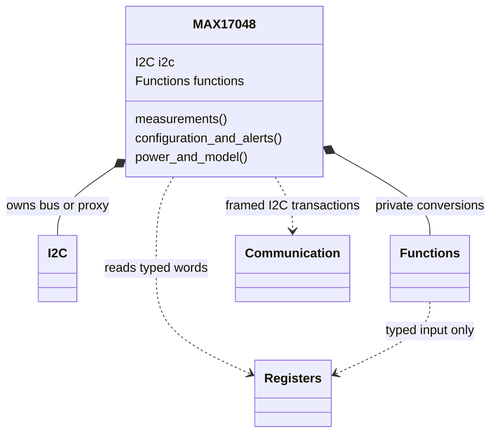
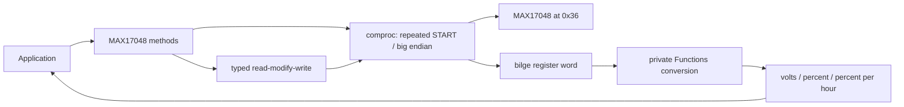

# MAX17048

Allocation-free, `no_std` Rust driver for the **one-cell MAX17048**, using
`embedded-hal` 1.0 blocking I2C. `bilge` types represent every documented
register, including odd-width fields. Optional `defmt` enables register/error
formatting and I2C trace logging. No floating-point math library is needed.
MAX17049 has a different voltage scale and is **not supported**.

```rust
use embedded_hal::i2c::I2c;
use max17048::{Error, MAX17048};

fn measure<I: I2c>(bus: I) -> Result<I, Error<I::Error>> {
    let mut gauge = MAX17048::new(bus); // no I/O or reset
    gauge.set_empty_alert_threshold(10)?;
    gauge.set_voltage_alert(3000, 4200)?;
    let voltage_volts = gauge.voltage()?;
    let charge_percent = gauge.soc()?;
    let rate_percent_per_hour = gauge.charge_rate()?;
    // Use the measurements in the application.
    let _ = (voltage_volts, charge_percent, rate_percent_per_hour);
    Ok(gauge.destroy())
}
```

## Interface groups

| Group | Methods |
|---|---|
| Ownership / raw typed reads | `new`, `destroy`, `read_register::<R>` |
| Measurements / identity | `voltage`, `soc`, `charge_rate`, `version`, `chip_id` |
| Hibernate | `get_hibernate_threshold`, `set_hibernate_threshold`, `hibernate_threshold`, `activity_threshold`, `set_hibernate_entry_threshold`, `set_activity_threshold`, `is_hibernating` |
| Sleep / restart | `enable_sleep`, `sleep`, `quick_start`, `reset` |
| Configuration | `get_config`, `set_config`, `set_compensation` |
| Alerts | `set_empty_alert_threshold`, `empty_alert_threshold`, `enable_state_of_charge_change_alert`, `is_active_alert`, `clear_alert`, `get_status`, `set_status`, `clear_status_flags`, `set_voltage_alert`, `voltage_alert` |
| Reset policy / model | `set_reset_voltage`, `reset_voltage`, `enable_reset_comparator`, `write_model_table` |

`get_*` and `read_register` return typed words, for example
`gauge.read_register::<max17048::register::ResetVoltage>()?`.
Construct a typed word with `Type::from(raw_u16)` and use its generated named
getters/setters; `u16::from(word)` retrieves the complete word.
`set_config` replaces policy but preserves ALRT; `set_status` updates only EnVR.
For `clear_status_flags`, set the flag fields you want to clear to `true`.
Clear selected STATUS causes **before** `clear_alert` releases the ALRT pin.
Neither reading STATUS nor clearing its flags implicitly clears CONFIG.ALRT.

See [REGISTERS.md](REGISTERS.md) for the complete map and
[FUNCTIONS.md](FUNCTIONS.md) for equations and per-operation behavior.

## Startup, reset, and power

Use pullups on SDA/SCL and on open-drain ALRT if used; tie unused QSTRT to GND.
The fixed 7-bit bus address is `0x36`, maximum clock 400 kHz. Power the
MAX17048 from its monitored cell according to the datasheet operating limits.
The constructor intentionally does not probe, clear reset flags, or reset a
running gauge. Read VERSION and STATUS, configure the application, then
acknowledge RI. No hard-coded version check rejects future revisions.

Allow approximately **1 second after POR** for the first SOC update.
VCELL updates every 250 ms in active mode and 45 s in hibernate mode.
Schedule waits in the application; no driver method waits for fresh samples.
The battery must be relaxed for reset/quick-start; most systems should **not**
quick-start routinely. POR restores defaults, including the factory model;
reload a custom model when required. RCOMP optimization/model qualification
requires manufacturer guidance, not an assumed universal temperature formula.

`reset()` writes `0x5400` to CMD. The device resets before the last-byte ACK,
so a NACK is expected. **The driver forwards that error**, since a missing
device and a successful reset can otherwise be indistinguishable. The
application must inspect the error, wait for startup, verify communication and
STATUS.RI, and reconfigure. Other errors are never suppressed or retried.

`sleep(true)` first enables MODE.EnSleep, then sets CONFIG.SLEEP. Software
sleep stops gauging; wake with `sleep(false)` **before** charging/discharging.
Other I2C communication does not wake software sleep. Setting HIBRT to
`HibernateThreshold::from(0)` disables hibernation; `0xffff` forces it.
The default `0x8030` automatically controls it and is preferred for higher loads.

## Shared buses and partial failures

Any `I2c` bus proxy (for example from `embedded-hal-bus`) can be passed directly.
There is only one interface, so no protocol builder is needed. Each register read
uses a repeated START; each word write sends address, MSB, LSB. Read-modify-write
is **not atomic** across transactions: exclusively own the MAX17048 while
configuring it. A shared bus lock usually protects individual transactions,
not an entire multi-step operation. Do not give multiple clients access to
the same gauge. SCL/SDA held low can enter sleep when EnSleep is enabled,
affecting other bus devices; the driver never deliberately holds lines low.

If a read fails, no dependent write is attempted. If a write fails, hardware
may already have accepted data; reread/recover before retrying. Sleep permission
may remain enabled after a later CONFIG failure. Unrelated alert latches are
preserved using write-one; selected flags acknowledged during a concurrent
same-kind event can still race. No rollback can restore a lost event.

`write_model_table` accepts exactly **32 words (64 bytes)** of a model obtained
and validated with manufacturer instructions. Unlock freezes ModelGauge
updates. The method stops on the first unlock/data error and **always attempts
both relock writes**. `Error::ModelTable` retains the transfer error and each
relock error independently. A partial table remains partial; if relocking
fails, gauging may remain frozen. Obtain exclusive device access and follow
manufacturer recovery/reinitialization instructions before trusting results.
This is a raw transfer, not a complete custom-model qualification algorithm.

## Structure





## Validation and references

Run from the repository root:

```sh
cargo fmt --manifest-path max17048/Cargo.toml -- --check
cargo test --manifest-path max17048/Cargo.toml --no-default-features
cargo test --manifest-path max17048/Cargo.toml --all-features
cargo clippy --manifest-path max17048/Cargo.toml --all-targets --no-default-features -- -D warnings
cargo clippy --manifest-path max17048/Cargo.toml --all-targets --all-features -- -D warnings
cargo doc --manifest-path max17048/Cargo.toml --no-default-features --no-deps
cargo doc --manifest-path max17048/Cargo.toml --all-features --no-deps
cargo build --manifest-path max17048/Cargo.toml --target thumbv7em-none-eabi --no-default-features
cargo build --manifest-path max17048/Cargo.toml --target thumbv7em-none-eabi --all-features
```

Tests use `embedded-hal-mock` for exact framing, endian order, field/latch
preservation, invalid arguments, interface errors, and multi-step failures.
**Hardware has not been tested.** Timing, battery-model accuracy, and electrical
operation still require board-level validation.

Specification: Maxim 19-6171, **Rev. 7 (11/16)**, linked in REGISTERS.md.
Current ADI endpoints could not be reached; latest revision and separate errata
remain unverified. Reference implementations inspected for comparison only:
[Rust max170xx-rs](https://github.com/eldruin/max170xx-rs) and
[Adafruit C++ MAX1704X](https://github.com/adafruit/Adafruit_MAX1704X).
The manufacturer's 64-byte TABLE map and word-wide ordinary transactions take
precedence over differences in reference drivers.

Migration from the unfinished skeleton: existing `MAX17048`, `new`, `destroy`,
measurement names, and module paths remain. SOC now correctly returns percent,
not raw Q8.8 counts. Previously unimplemented setters now take typed values;
errors implement `Debug`, and invalid arguments use `InvalidInputData`.
