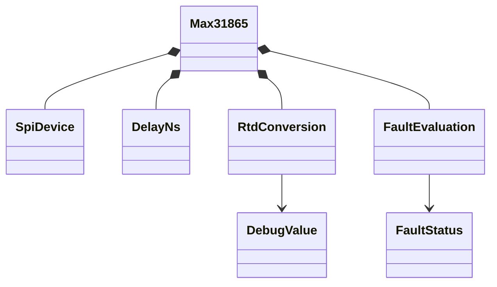
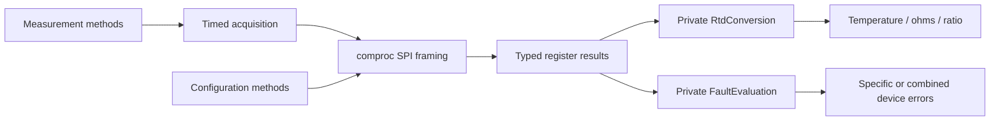

# MAX31865

Blocking, allocation-free `no_std` driver for the Analog Devices / Maxim MAX31865
RTD-to-digital converter, using `embedded-hal` 1.0 `SpiDevice` and `DelayNs`.
Registers are typed with `bilge`; optional `defmt` provides diagnostics.
`libm` is used only for the square root in the existing temperature algorithm.

The original driver was reported hardware-tested by the user. This convention
alignment preserves its successful startup sequence, default 60 Hz acquisition
transactions/delays, threshold write order, and positive/negative temperature
calculation. Those paths are protected by regression tests. The refactored
version has **not** been rerun on hardware.

```rust
use embedded_hal::{delay::DelayNs, spi::SpiDevice};
use max31865::{Max31865, Numwires, error::Max31865Err};

fn measure<S: SpiDevice, D: DelayNs>(
    spi: S,
    delay: D,
) -> Result<f32, Max31865Err<S::Error>> {
    let mut sensor = Max31865::try_new(
        spi, delay, Numwires::MAX31865_3_WIRE, 100.0, 430.0,
    )?;
    sensor.temperature()
}
```

Nominal RTD resistance and reference resistor values are in ohms. Use the actual
reference resistor on the board, not an assumed value. Positive finite values
are required. PT100 and PT1000 require appropriate external reference resistors
and the matching platinum curve; the chip returns a ratio, not temperature.

## Sources and device variants

Implemented against **19-6478, Rev 3, 7/15**, the latest publicly located
MAX31865 revision when checked 2026-10-23:
[official datasheet](https://www.analog.com/media/en/technical-documentation/data-sheets/MAX31865.pdf),
[manufacturer-authored PDF mirror](https://cdn-learn.adafruit.com/assets/assets/000/037/309/original/MAX31865.pdf).
The official download was unavailable from this environment; the mirrored PDF's
revision and register tables were verified directly. No separate public errata
was located. Rev 3 changes Table 6, which is reflected in the typed threshold
layout. AAP (SSOP) and ATP (TQFN-EP) share the register interface; +T indicates
tape-and-reel, not a different protocol. Respect the package-specific pinout.

The existing references,
[Adafruit's MAX31865 driver](https://github.com/adafruit/Adafruit_MAX31865) and
[rudihorn's Rust driver](https://github.com/rudihorn/max31865), were consulted for
context, not copied into this refactor.

## Startup, conversion and compatibility

Configure the external SPI device for **mode 1 or mode 3**, MSB-first, at most
5 MHz. The HAL/device adapter must meet the datasheet CS setup/inactive minimum
of 400 ns, CS hold minimum of 100 ns, and all signal timing limits. A shared-bus
adapter must select the right mode/rate for each transaction.

`try_new` performs the original startup operations:

1. Read-modify-write the wire configuration.
2. Enable bias, then wait 20 ms.
3. Enable automatic conversion.
4. Write raw low/high thresholds 0000/FFFF, low LSB/MSB then high LSB/MSB.
5. Clear faults without replaying one-shot or fault-cycle commands.

There is no software reset command or identity register. Construction does not
assume power-on defaults: stable configuration fields are read and preserved.
The initial filter selection is retained from the existing hardware state.
Use the correct physical RTD wiring and board jumpers; selecting a wire count
in software does not rewire FORCE/RTDIN connections.

`read_rtd` and every derived measurement preserve the original acquisition path:
clear faults, enable bias, wait 10 ms, request a one-shot, wait 65 ms at 60 Hz
(now 66 ms at 50 Hz to meet the datasheet maximum), burst-read the RTD pair,
then disable bias. Automatic-conversion selection is deliberately preserved,
including its interaction with bias; this is not a new continuous-stream API.
Per the datasheet, one-shot is effective only in normally-off mode, and automatic
mode keeps bias enabled. Call `auto_convert(false)` after initialization if true
one-shot behavior and bias power-down are required. The retained legacy sequence
does not promise a new sample beyond what the configured conversion mode permits.

The fixed 10 ms preconversion delay is retained for the tested board. Datasheet
accuracy requires at least **10.5 external RC time constants plus 1 ms** after
bias is enabled. Confirm that this fits your board's filter and startup behavior.
Larger RC networks need a separately timed sequence using raw register access;
this change does not silently lengthen the tested board's default acquisition.

Changing 50/60 Hz notch selection while automatic conversion is enabled now
stops automatic mode, changes the filter, and restores it. A write failure can
leave automatic mode disabled; the original interface error is returned.

### Error/API migration

`new` remains available but is deprecated: it retains the old panic-on-startup-
failure contract for source compatibility. Use `try_new` to receive the original
interface error. Normal methods no longer panic on write failures.

Errors are now `Max31865Err<S::Error>`, with `Interface(original_error)` replacing
the old lossy read/write-only classification. Explicit return annotations should
include the SPI error type. `ReadTrait` and `WriteTrait` now have an
`InterfaceError` associated type. The old `SpiErr`, `Operation`, raw `Register`
constants, `Numwires` constants and method names remain available for migration.
`FaultCycle` is now publicly re-exported so `read_fault` is actually usable.

Intentional correctness changes:

- `get_ratio`, `get_resistance`, and debug ratio/resistance now divide ADC counts
  by 32768 rather than multiplying; the temperature path already divided.
- Simultaneous fault flags no longer look like success. A fault-marked RTD word
  with no detailed status returns `UnspecifiedRtdFault`.
- Faulted samples inspect latched status instead of starting an unfinished manual
  detection cycle that could leave the FORCE- switch open.
- Read-modify-write never replays transient command bits. The compatibility
  `FaultRegister` bitflags now contain bit masks rather than bit indices.
- Invalid resistor inputs and nonfinite temperature results are explicit errors.

`DebugValue` now consistently contains temperature in degrees Celsius,
resistance in ohms, and dimensionless ratio from one acquisition.

## Register and method groups

| Group | Methods |
|---|---|
| Lifecycle | `try_new`, deprecated `new`, `release` |
| Typed readback | `read_configuration`, `read_resistance_register`, `read_fault_status`, `read_lower_threshold`, `read_upper_threshold` |
| Configuration | `set_wires`, `enable_bias`, `auto_convert`, `enable_50hz` |
| Faults | `clear_fault`, `read_fault` |
| Measurements | `read_rtd`, `temperature`, `get_ratio`, `get_resistance`, `get_debug_value` |
| Thresholds | `set_threshold`, `get_lower_threshold`, `get_upper_threshold` |
| Compatibility raw access | `ReadTrait::{read_u8, read_u16, read_n}`, `WriteTrait::write_u8` |

`set_threshold` and legacy getters use shifted 16-bit register words, **not**
the unshifted 15-bit counts returned by `read_rtd`. For count 8192, pass 0x4000.
Typed `FaultThreshold` exposes the `u15` count separately. The don't-care low
bit is preserved on raw reads/writes. Thresholds are inclusive comparison limits.

`read_fault(FaultCycle::None)` inspects the current latched status without
clearing it. Other cycle modes disable auto conversion and enable bias, retaining
wire/filter selections. Automatic detection waits 1 ms and is appropriate only
for external input RC time constants no greater than 100 us. Manual mode requires
the application to ensure bias has settled for at least 5 RC time constants,
call `ManualRun`, wait another 5 time constants, then call `ManualFinish`.
ManualRun's immediate status read is a snapshot, **not** proof of completed fault
detection. ManualFinish adds 1 ms before its snapshot. Complete a manual cycle
before acquiring RTD data; restore conversion settings explicitly afterward.

## Shared buses and non-atomic failures

Reads hold one CS assertion across an address write and data read. Register words
are read in one big-endian burst. `SpiDevice` owns CS and transaction locking,
so `embedded-hal-bus` or a HAL-native sharing adapter can be supplied externally.
Only SPI is supported; a multi-protocol builder is unnecessary. Async HAL support
was not implemented in the original driver and is not added by this refactor;
unused async/bus dependencies were removed.

Bus locking covers one transaction, not an entire conversion, read-modify-write,
filter change, or four-byte threshold update. Do not allow another owner to
modify the same device during these sequences. Other bus devices may run between
transactions, but application scheduling must honor timing assumptions.

All failures stop immediately and preserve the original error. No rollback or
best-effort cleanup masks it. A failure can leave bias enabled, a conversion
running, partial thresholds, a manual fault cycle open, or configuration changed.
`release` returns `(spi, delay)` without cleanup. A failed `try_new` drops its
resources and may already have changed hardware. Recover at the application
level: restore bus operation, complete any manual fault cycle, reapply the desired
configuration/thresholds, and perform a fresh conversion. Power-cycle if hardware
state cannot be established. Constructor retries alone are not a reset.

## Ownership and processing





The complete map and access rules are in [REGISTERS.md](REGISTERS.md).
Equations and processing functions are in [FUNCTIONS.md](FUNCTIONS.md).

## Validation

Run inside `max31865`:

```text
cargo fmt --check
cargo test --no-default-features
cargo test --all-features
cargo clippy --all-targets --no-default-features -- -D warnings
cargo clippy --all-targets --all-features -- -D warnings
cargo doc --no-deps --no-default-features
cargo doc --no-deps --all-features
cargo build --target thumbv7em-none-eabi --no-default-features
cargo build --target thumbv7em-none-eabi --all-features
```

Tests cover the original working path, typed data processing, register
preservation, SPI framing and multi-step failure forwarding. The original driver
was reported working on hardware; all new/refactored behavior still requires
hardware regression testing.
