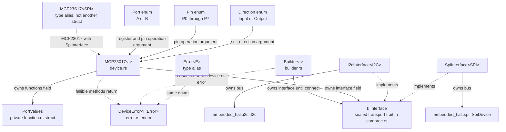
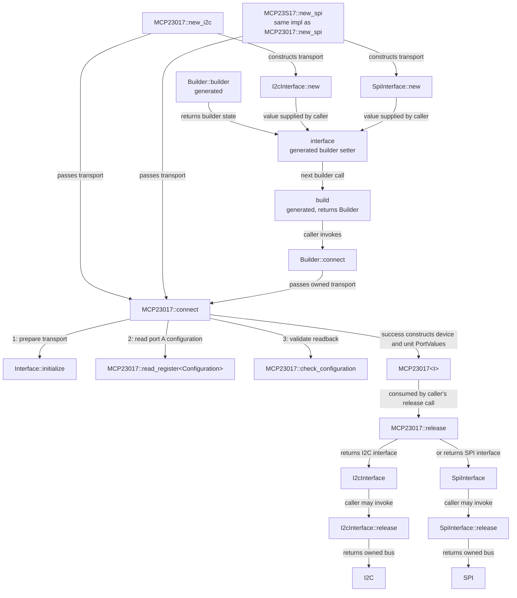
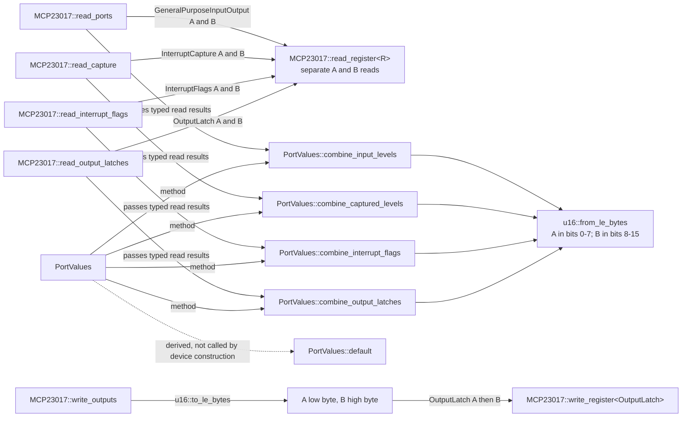
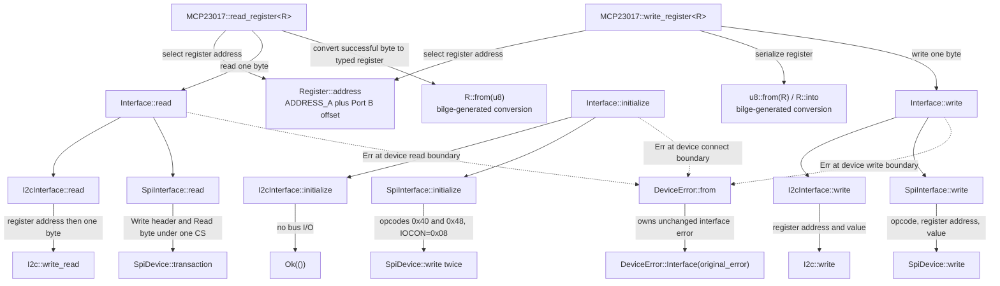

# MCP23017 / MCP23S17

Allocation-free, `no_std`, blocking `embedded-hal` 1.0 driver for Microchip's
16-bit GPIO expanders. Supports I2C (MCP23017) and SPI (MCP23S17), bilge-typed
registers, direction, pull-ups, polarity inversion, output latches, interrupt
configuration, source flags and captured input states. Optional `defmt` logging
reports initialization, invalid configurations and bus failures.

## I2C

```rust
use embedded_hal::i2c::I2c;
use mcp23017::{u3, DeviceError, Direction, MCP23017, Pin, Port};

fn example<I: I2c>(i2c: I) -> Result<(), DeviceError<I::Error>> {
    // Address pins A2:A0 = 000 => I2C address 0x20.
    let mut device = MCP23017::new_i2c(i2c, u3::new(0))?;
    device.set_output(Port::A, Pin::P0, true)?;
    device.set_direction(Port::A, Pin::P0, Direction::Output)?;
    device.set_pull_up(Port::B, Pin::P6, true)?;
    let _levels = device.read_ports()?;
    let _i2c = device.release().release();
    Ok(())
}
```

## SPI

Supply a configured `SpiDevice<u8>` (SPI mode 0 or 3) which manages CS, not a
bare `SpiBus`. Use a clock within the datasheet limit for your supply voltage.

```rust
use embedded_hal::spi::SpiDevice;
use mcp23017::{u3, DeviceError, MCP23S17};

fn example<S: SpiDevice<u8>>(spi: S) -> Result<(), DeviceError<S::Error>> {
    let mut device = MCP23S17::new_spi(spi, u3::new(5))?;
    device.write_outputs(0x1234)?;
    Ok(())
}
```

## Typed builder and registers

```rust
use embedded_hal::i2c::I2c;
use mcp23017::{
    builder::Builder, comproc::I2cInterface,
    register::{Configuration, InputDirection}, u3, DeviceError, Direction, Port,
};

fn example<I: I2c>(i2c: I) -> Result<(), DeviceError<I::Error>> {
    let mut device = Builder::builder()
        .interface(I2cInterface::new(i2c, u3::new(2)))
        .build()
        .connect()?;
    let mut direction = device.read_register::<InputDirection>(Port::A)?;
    direction.set_pin3(Direction::Output);
    device.write_register(Port::A, direction)?;
    let mut config = device.read_register::<Configuration>(Port::A)?;
    config.set_interrupt_open_drain(true);
    device.write_configuration(config)?;
    Ok(())
}
```

Select `SpiInterface::new(spi, address_pins)` instead for the SPI builder.
`u3` restricts address-pin values to 0-7; these are pin levels, **not** full I2C
addresses. `Pin` restricts pin indices to 0-7 within the selected `Port`.

## Struct and function connections

These diagrams cover every library struct and handwritten function, including
private helpers. Repeated bilge-generated register methods and typed-builder
methods are grouped explicitly. Test-only helpers and compiler-generated
formatting, copying and equality implementations are omitted.

Arrows show ownership, calls or data flow as labeled. Method names repeated
across diagrams refer to the same implementation. Register values are passed
through device methods, not cached as device fields.

### Device ownership and interface selection



### Construction and resource release

`connect` is private to the crate; applications use a constructor or the builder.
Its numbered edges show initialization order. Releasing a device returns its
interface; releasing that interface is a separate application call.



### Pin operations, configuration and private helpers

Edge labels on setters identify the register type used by `update_bit`.
Read-modify-write preserves neighboring bits and returns immediately on error.
Output updates use `OutputLatch`, never a GPIO read.

```mermaid
flowchart TD
    direction["MCP23017::set_direction"]
    pullUp["MCP23017::set_pull_up"]
    polarity["MCP23017::set_input_inverted"]
    interruptEnable["MCP23017::set_interrupt_enabled"]
    comparison["MCP23017::set_interrupt_comparison"]
    defaultLevel["MCP23017::set_interrupt_default"]
    output["MCP23017::set_output"]
    update["MCP23017::update_bit&lt;R&gt;<br/>private"]
    read["MCP23017::read_register&lt;R&gt;"]
    write["MCP23017::write_register&lt;R&gt;"]
    mask["Pin::mask<br/>private, returns one-bit u8 mask"]
    readPin["MCP23017::read_pin"]
    configuration["MCP23017::write_configuration"]
    check["MCP23017::check_configuration<br/>private"]

    direction -->|"InputDirection"| update
    pullUp -->|"PullUpResistors"| update
    polarity -->|"InputPolarity"| update
    interruptEnable -->|"InterruptEnable"| update
    comparison -->|"InterruptControl"| update
    defaultLevel -->|"InterruptDefaultValue"| update
    output -->|"OutputLatch"| update
    direction -->|"MCP23017 P7 input rejected before I/O"| unsupported["DeviceError::UnsupportedInputPin"]
    update -->|"1: previous register value"| read
    update -->|"2: select bit"| mask
    update -->|"3: modified register value"| write
    mask -->|"converts Pin to its three-bit index"| index["u3::from(Pin).value"]
    readPin -->|"GeneralPurposeInputOutput"| read
    readPin -->|"mask selected level"| mask
    configuration -->|"1: validate requested Configuration"| check
    configuration -->|"2: write IOCON at 0x0A"| interfaceWrite["Interface::write"]
    check -->|"reads three generated field getters"| fields["Configuration::separate_register_banks<br/>Configuration::unimplemented_bit<br/>Configuration::hardware_address_enable"]
    check -->|"BANK=1"| bank["DeviceError::UnsupportedRegisterBank"]
    check -->|"reserved bit=1"| reserved["DeviceError::ReservedConfigurationBitSet"]
    check -->|"SPI HAEN=0"| addressing["DeviceError::HardwareAddressingDisabled"]
```



### Combined port operations and register-result processing

The device reads A then B before calling `PortValues`; each conversion puts A
in the low byte and B in the high byte. `PortValues` performs no bus I/O.



### Register transactions and error forwarding

The `Interface` methods dispatch statically to the selected transport. Each
device boundary wraps an interface failure using `DeviceError::from`; `?`
forwards that error through the calling operation without replacing its payload.
I2C initialization is a no-op; SPI initialization performs two startup writes.



### Every typed register and generated methods

All eleven register structs implement `Register`, with addresses and reset
values supplied by the local `register!` macro. Only the eight types connected
to `WritableRegister` support `write_register`; `Configuration` instead requires
the checked `write_configuration` method. Both traits are sealed.

For repeated methods below, `N` expands to each index from 0 through 7 and
`field` expands to each named configuration field listed in the final node.
Generated setters modify an in-memory value, even for read-only register types;
they do not grant permission to write that value to hardware.

```mermaid
flowchart TD
    subgraph registers["Register structs in register/"]
        inputDirection["InputDirection"]
        inputPolarity["InputPolarity"]
        interruptEnable["InterruptEnable"]
        interruptDefault["InterruptDefaultValue"]
        interruptControl["InterruptControl"]
        configuration["Configuration"]
        pullUps["PullUpResistors"]
        flags["InterruptFlags"]
        capture["InterruptCapture"]
        gpio["GeneralPurposeInputOutput"]
        latch["OutputLatch"]
    end

    registers -.->|"all implement"| readable["Register"]
    readable -->|"provided method"| address["Register::address(Port)"]
    readable -->|"required conversions"| conversion["R::from(u8) and u8::from(R) / R::into"]
    registers -.->|"register! implements"| defaults["R::default"]
    defaults -->|"RESET value"| conversion
    registers -.->|"bilge generates"| constructor["R::new<br/>typed field arguments"]
    registers -.->|"bilge generates for all except Configuration"| accessors["pinN / set_pinN<br/>for all ten per-pin structs"]
    configuration -.->|"uses named fields instead of pinN"| configAccessors["field / set_field<br/>unimplemented_bit<br/>interrupt_active_high<br/>interrupt_open_drain<br/>hardware_address_enable<br/>slew_rate_disabled<br/>sequential_operation_disabled<br/>mirror_interrupts<br/>separate_register_banks"]
    inputDirection -->|"getter/setter field type"| direction["Direction enum<br/>From and Into u1"]
    inputPolarity -.-> writable["WritableRegister"]
    inputDirection -.-> writable
    interruptEnable -.-> writable
    interruptDefault -.-> writable
    interruptControl -.-> writable
    pullUps -.-> writable
    gpio -.-> writable
    latch -.-> writable
    writable -->|"extends"| readable
    writable -->|"bound for"| write["MCP23017::write_register"]
    readable -->|"bound for"| read["MCP23017::read_register"]
    configuration -->|"checked hardware write only"| checked["MCP23017::write_configuration"]
```

## Hardware and ownership requirements

- DS20001952D specifies **GPA7 and GPB7 are output-only on MCP23017**.
  Use only pins 0-6 on each port for inputs, pull-ups and interrupt sources.
  `set_direction` rejects `Input` for these two pins. Raw typed-register writes
  remain low-level and must respect this restriction. MCP23S17 has no such limit.
- Start after hardware reset/power-on, with BANK=0; no software reset exists.
  Constructors do not recover arbitrary pre-existing BANK=1 configurations.
  Do not reset or reconfigure the chip outside the driver while it is in use.
- Keep RESET deasserted and address pins externally biased. Respect voltage,
  current, startup/reset timing and bus pull-up requirements from the datasheet.
- SPI initialization writes IOCON=0x08 using both 0x40 and 0x48 startup opcodes
  to cover the A2 silicon erratum. This enables HAEN on **all reset devices
  sharing CS** and resets their IOCON settings; initialize the group before
  customizing IOCON on any member. Other I/O registers are not reset.
- All register transfers are one byte, so either SEQOP setting is supported.
  BANK=1, a set reserved IOCON bit, or disabling SPI HAEN is rejected explicitly.
- Port A is the low byte of sixteen-bit values. A/B access is sequential, not
  atomic; a failure on B can leave A written or its interrupt acknowledged.
- Reading GPIO or INTCAP acknowledges that port's interrupt. Read INTF before
  capture and avoid unrelated GPIO reads while servicing interrupts.
  Output updates read OLAT, not GPIO. Set the latch before changing direction.
- Errors preserve the underlying bus error; there is no silent fallback/retry.
  A failed constructor consumes the supplied interface. Keep a recoverable
  shared-bus handle in the application if reconnection is required.

See [REGISTERS.md](REGISTERS.md) for every address, field and read requirement,
and [FUNCTIONS.md](FUNCTIONS.md) for processing and device operations.

## Device errors

Every fallible device operation, including constructors and builder connections,
returns `DeviceError<I::Error>`, defined in `error.rs` and exported at the crate
root. `Error<E>` remains a short alias for the same enum.

| Variant | Meaning |
|---|---|
| `Interface(error)` | Original HAL interface error, including any device-specific payload owned by that error. |
| `UnsupportedRegisterBank` | IOCON requests BANK=1 instead of the supported BANK=0 map. |
| `ReservedConfigurationBitSet` | IOCON's unimplemented bit is set. |
| `HardwareAddressingDisabled` | MCP23S17 hardware addressing is disabled. |
| `UnsupportedInputPin` | MCP23017 GPA7 or GPB7 was requested as an input. |

Interface failures are forwarded unchanged, not reduced to `ErrorKind`, replaced
with a configuration error, logged and discarded, or converted to success.
Optional `defmt` logging supplements error returns; it never replaces them.
`From<I::Error>` wraps the original value as `DeviceError::Interface(error)`.
When multiple configuration bits are invalid, validation reports BANK first,
then the reserved bit, then disabled SPI addressing, before performing writes.

Code matching the previous `Error::Bus(error)` variant should now match
`DeviceError::Interface(error)`. The former generic `InvalidConfiguration` is
replaced by the three specific configuration variants above.

## Validation

```text
cargo test --manifest-path mcp23017/Cargo.toml
cargo test --manifest-path mcp23017/Cargo.toml --all-features
cargo clippy --manifest-path mcp23017/Cargo.toml --all-targets --all-features -- -D warnings
```

Tests use `embedded-hal-mock` for bus framing, errors, register preservation,
interrupt reads and SPI initialization. No physical hardware validation is
claimed.

## References

- Microchip [MCP23017/MCP23S17 datasheet DS20001952D](https://ww1.microchip.com/downloads/aemDocuments/documents/APID/ProductDocuments/DataSheets/MCP23017-Data-Sheet-DS20001952.pdf),
  especially sections 3.2-3.6.
- Microchip [MCP23S17 revision A errata DS80311A](https://ww1.microchip.com/downloads/aemDocuments/documents/OTH/ProductDocuments/Errata/80311a.pdf).
- Existing Rust [`mcp23017` driver](https://github.com/circuitry-maker/mcp23017)
  and [its register-access implementation](https://docs.rs/mcp23017/latest/src/mcp23017/lib.rs.html)
  consulted as references only. This driver is independently implemented with
  embedded-hal 1.0, typed registers and explicit port-byte ordering.
