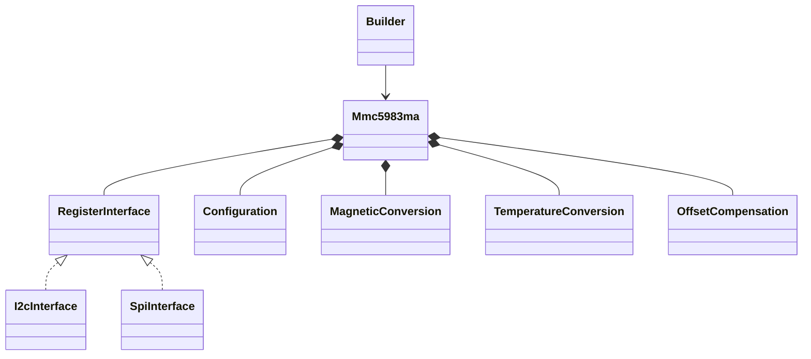
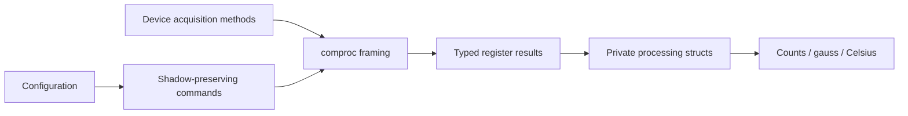

# MMC5983MA

`no_std`, allocation-free, blocking `embedded-hal` 1.0 driver for MEMSIC's
MMC5983MA three-axis magnetometer. Supports I2C and four-wire SPI through
protocol-typed adapters, typed `bilge` registers, and optional `defmt` diagnostics.
No floating-point math library is needed. Async and half-duplex three-wire SPI
are not implemented.

```rust
use mmc5983ma::{Mmc5983ma, builder::Builder, comproc::I2cInterface};
use embedded_hal::{i2c::I2c, delay::DelayNs};

fn sample<I: I2c, D: DelayNs>(
    bus: I,
    delay: &mut D,
) -> Result<mmc5983ma::MagneticMeasurement, mmc5983ma::Error<I::Error>> {
    let mut sensor = Builder::builder()
        .interface(I2cInterface::new(bus))
        .build()
        .build_device();
    sensor.initialize(delay)?;
    sensor.measure_magnetic_field(delay)
}
```

For SPI, replace the adapter with `SpiInterface::new(spi_device)`. The HAL or
`embedded-hal-bus` adapter must provide a `SpiDevice`, not a raw `SpiBus`.
`release().release()` returns the underlying bus/device.

## Sources and hardware requirements

Implemented against [MEMSIC MMC5983MA Rev A, formal release 2019-04-03](https://www.memsic.com/Public/Uploads/uploadfile/files/20220119/MMC5983MADatasheetRevA.pdf),
the PDF linked on the [manufacturer product page](https://www.memsic.com/magnetometer-5)
when checked 2026-10-23. No separate public errata was found. The ordering guide
specifies address code 3 (0x30), industrial grade M, and LGA16 package A.
Other MMC59xx devices, including MMC5983 variants with different suffixes,
are not assumed register-compatible. Product ID 0x30 alone is not a unique
family discriminator; verify the physical part.

The [SparkFun Arduino driver](https://github.com/sparkfun/SparkFun_MMC5983MA_Magnetometer_Arduino_Library)
was consulted for interface reference only; this is an independent implementation.
Its SPI notes report mode 0 working in practice, while Rev A pages 4-5 describe
idle-high clock, falling-edge drive and rising-edge capture (mode 3).
Configure mode 3, MSB-first, at most 10 MHz according to the datasheet;
verify timing on the actual board. The driver does not configure the bus.
I2C supports at most 400 kHz and requires CS tied to VDDIO and suitable pull-ups.
Use the supply limits, decoupling and 10 uF CAP capacitor specified by MEMSIC.

Call `initialize` after stable power. It waits 10 ms, checks identity, issues
software reset, waits another 10 ms, checks OTP completion and performs SET.
This resets configuration. SET/RESET pulses are specified as 500 ns, but
Rev A gives no host settling maximum; this driver conservatively waits 1 ms.
Rev A also has inconsistent bandwidth/rate descriptions (pages 2, 12 and 15).
Configuration uses the explicit page-15 BW timing and page-16 rate constraints;
validate rates and settling in the target application.

## API groups

| Group | Methods |
|---|---|
| Lifecycle | `new`, typed `Builder`, `initialize`, `release` |
| Registers / configuration | `read_product_id`, `read_status`, `configuration`, `configure`, `clear_interrupts` |
| Acquisition | `measure_magnetic_field`, `measure_temperature`, `read_magnetic_field`, `read_temperature` |
| Conditioning | `set`, `reset`, `reload_otp`, `measure_offset_compensated` |

Control registers are write-only. `configuration()` returns tracked stable
settings, never hardware readback. Command bits are not persisted or replayed.
Build settings with `Configuration::default()` and typed register setters:

```rust
use mmc5983ma::{Configuration, register::{Bandwidth, ContinuousFrequency}};
let mut configuration = Configuration::default();
configuration.control0.set_automatic_set_reset_enabled(true);
configuration.control1.set_bandwidth(Bandwidth::Hertz200);
configuration.control2.set_frequency(ContinuousFrequency::Hertz200);
configuration.control2.set_continuous_measurement_enabled(true);
assert!(configuration.validate().is_ok());
```

All reads of magnetic/temperature data first require the corresponding completion
bit; they do not consume a sample or guarantee freshness. Interrupt acknowledgement
is explicit. Single-shot methods clear the corresponding old interrupt, start a
measurement and poll with 1 ms delays. The default builder limit is 20 polls;
override `poll_limit` with a `NonZeroU16`. Continuous mode disallows single-shot
commands. Conversion timeout requires reinitialization to avoid racing an active
conversion. Offset cancellation requires automatic S/R off and restores SET on
success; normal raw conversion assumes SET polarity. Calling `reset` deliberately
reverses polarity until `set` is called again.

## Shared buses and partial failures

I2C register reads use repeated-start `write_read`. Each SPI read keeps the
command and payload under one CS assertion with `SpiDevice::transaction`.
Use an external embedded-hal bus-sharing adapter when needed. It locks a single
transaction, not a whole conversion/configuration. Do not allow another owner
to access the same sensor: its write-only settings would invalidate this driver's
shadow. Do not externally reset the sensor without calling `initialize` again.

`configure(settings, delay)` first stops continuous mode, waits 10 ms for an
in-flight conversion, then writes controls 0, 1, 3 and 2.
This does not roll back on failure. Any write error can mean the byte reached the
sensor; it invalidates initialization and preserves the original interface error.
Recover by reinitializing and reapplying the desired settings. A failed read
never returns fabricated data. A read failure during acquisition can leave a
conversion running; acquisition errors invalidate initialization so recovery is
required before issuing another measurement command.
Offset-compensation failures can leave RESET polarity or an active measurement;
no additional cleanup I/O is attempted that could obscure the original failure.
Continuous reads use one seven-byte burst, but Rev A does not promise an atomic
output latch; stop continuous mode and use single-shot acquisition when a coherent
stationary output bank is required.

## Ownership and processing





See [REGISTERS.md](REGISTERS.md) and [FUNCTIONS.md](FUNCTIONS.md) for complete
register access requirements and conversion equations.

## Validation

Run from this directory:

```text
cargo fmt --check
cargo test --no-default-features
cargo test --all-features
cargo clippy --all-targets --all-features -- -D warnings
cargo clippy --all-targets --no-default-features -- -D warnings
cargo doc --no-deps --all-features
cargo doc --no-deps --no-default-features
cargo build --target thumbv7em-none-eabi --no-default-features
cargo build --target thumbv7em-none-eabi --all-features
```

Mock tests cover wire framing, state preservation, conversion results and partial
failures. The commands above passed on the host and `thumbv7em-none-eabi`,
both with and without `defmt` (22 unit/integration tests and two documentation
tests in each feature configuration). Hardware has not been tested; electrical
timing, continuous coherency, OTP reload timing and accuracy require board-level
verification.
