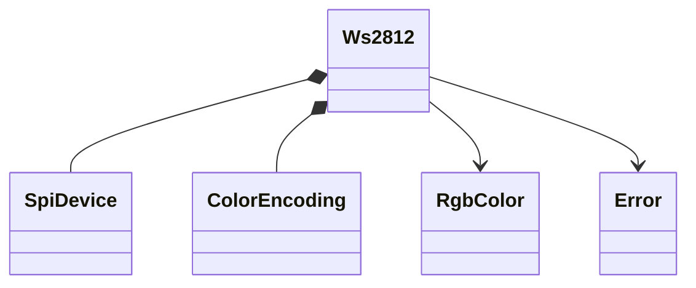
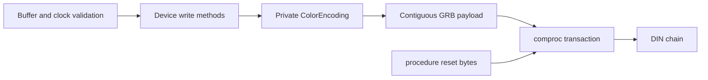

# WS2812B-2020

Allocation-free, `no_std` driver for Worldsemi WS2812B-2020 LEDs, using SPI to
generate the single-wire waveform. Supports blocking `embedded-hal` 1.0 and
optional `embedded-hal-async` 1.0. Optional `defmt` provides diagnostics.

```rust
use embedded_hal::spi::SpiDevice;
use ws2812::{Error, RgbColor, Ws2812};

fn display<S: SpiDevice<u8>>(spi: S) -> Result<S, Error<S::Error>> {
    // Configure the actual HAL beforehand: MSB-first, mode 0, 3.0-3.2 MHz.
    let mut leds = Ws2812::try_new(spi, 3_200_000)?;
    leds.write_colors(&[
        RgbColor::new(255, 0, 0),
        RgbColor::new(0, 255, 0),
        RgbColor::new(0, 0, 255),
    ])?;
    Ok(leds.release())
}
```

The original `RGB::new`, `Ws2812::new`, `write_color` and array-based
`write_colors` remain available. SPI errors are now wrapped as `Error::Interface`
so device validation errors can also be returned. The former implementation's
out-of-range RGB copies, reversed bit ordering, and per-pixel transactions are
replaced by contiguous GRB/MSB-first frame encoding with reset/latch intervals.

## Datasheet and compatibility

Based on Worldsemi's **WS2812B-2020**, unversioned 10-page datasheet, pages 4-5,
[current LCSC mirror](https://www.lcsc.com/datasheet/C965555.pdf)
([direct PDF](https://datasheet.lcsc.com/datasheet/pdf/fa8a6e6f798ba5cc95814978f8bc7219.pdf?productCode=C965555)),
checked 2026-10-23. No separately published errata was located. The manufacturer's
current catalog advertises newer variants; its old datasheet download endpoints
were unavailable. A latest manufacturer revision could not be independently
confirmed. See [PROCEDURE.md](PROCEDURE.md) for the verified timing requirements.

The 2020 suffix is the package size, not a revision year. Older WS2812/WS2812B
parts and newer V5/V6/V7 parts differ in timing, reset duration, supply limits,
channel current and input thresholds. This implementation targets the timing
table for **WS2812B-2020 only**. It does not claim compatibility with RGBW parts,
SK6812, or every WS2812-branded strip. It has no readback or chip ID to detect
the installed variant.

The manufacturer datasheet was authoritative; the existing
[smart-leds WS2812 SPI implementation](https://github.com/smart-leds-rs/ws2812-spi-rs)
was consulted only as reference. Its alternative symbol timing is not copied:
the selected `1000`/`1100` symbols satisfy this part's 580 ns minimum T1L.

## Wiring and startup

Route MOSI to DIN; do not connect SPI SCK or CS to the LEDs. The supplied
`SpiDevice<u8>` must implement mode 0, MSB-first, with actual clock in
**3.0-3.2 MHz**, including oscillator/divider tolerance. `try_new` validates the
frequency supplied by the caller, not the hardware. Prefer an achievable clock
inside the allowed range to leave tolerance margin; 3.2 MHz is the upper bound.

The source lists 3.7-5.3 V supply ratings and a DIN high threshold of 0.65 VDD.
A 3.3 V MCU output is not guaranteed to meet this at every supported supply
voltage. Use an appropriate level shifter, common ground, suitable power
distribution and board decoupling; follow the exact board/part documentation.
Do not rely on contradictory high-voltage marketing statements in the datasheet
instead of its supply rating table.

Construction performs no I/O. After stable power, a nonempty write always sends
128 zero bytes (at least 320 us) before data and another 128 afterward. This
initializes frame boundaries and latches the result without relying on MOSI's
power-up level or on CPU busy-wait delays. Use an external pull-down if DIN must
remain low while the MCU/peripheral is unconfigured. Success means the HAL
completed transmission, not that an LED acknowledged it.

## API groups and memory

| Group | Blocking methods | Async methods (`async` feature) |
|---|---|---|
| Ownership | `new`, `try_new`, `release` | Same constructors and release |
| Array / single LED | `write_colors`, `write_color` | `write_colors_async`, `write_color_async` |
| Caller storage | `write_colors_buffered` | `write_colors_buffered_async` |
| Reset/latch only | `latch` | `latch_async` |

`write_colors(&[RgbColor; N])` uses a 12N-byte local encoded payload. This can
exhaust a small MCU stack for large N; use the buffered method with caller-owned
storage in that case. Async array writes retain this payload in the future.
`RGB` is an alias for `RgbColor`. `Constant` and `Nanos` compatibility names
remain, with nominal timing durations rounded up to integer nanoseconds;
the waveform itself uses SPI clock ticks, not these rounded software delays.

```rust
use embedded_hal::spi::SpiDevice;
use ws2812::{Error, RgbColor, Ws2812};

fn display_slice<S: SpiDevice<u8>>(
    leds: &mut Ws2812<S>,
    colors: &[RgbColor],
    scratch: &mut [u8],
) -> Result<(), Error<S::Error>> {
    // scratch must contain at least 12 * colors.len() bytes.
    leds.write_colors_buffered(colors, scratch)
}
```

Scratch beyond the encoded payload is preserved and not transmitted. Too-small
buffers are rejected before buffer mutation or I/O. Empty input is a no-op.
`write_color` starts a new frame at the first LED: repeated calls cannot build a
chain. Supply all colors in one call. Shorter frames do not clear omitted pixels.
`latch` is not a clear-to-black operation.

## Bus timing, sharing and partial failures

Each frame is one transaction: zero prefix, a **single contiguous payload write**,
and zero suffix. This avoids CPU/software gaps between pixels. The HAL must still
provide uninterrupted, in-spec SPI output inside that payload; `embedded-hal`
does not guarantee byte-to-byte timing. MOSI must stay low across operation
boundaries and when idle. Verify the waveform on hardware with actual interrupt,
DMA and async scheduling load. Prefer DMA-backed HAL implementations.

WS2812B has **no chip select**. Bus locking/CS provided by `SpiDevice` cannot
prevent other devices' MOSI traffic from changing the LEDs. Use a dedicated MOSI
line/peripheral or external hardware gating that holds DIN low. For a standalone
SPI peripheral, a compatible device adapter (for example
`embedded-hal-bus::spi::ExclusiveDevice` with an unused CS output) may be used;
do not connect its CS to DIN. Only one wire protocol is supported, so no
protocol-selection builder is needed.

SPI errors are forwarded unchanged inside `Error::Interface`. An error during
any operation can leave partial colors visible, and no rollback is possible.
Cleanup is not attempted because it might mask the original failure. Repair or
reinitialize the peripheral as appropriate, then resend the entire chain; every
frame has a reset prefix to recover framing. Cancellation of an async write has
the same uncertainty. There is no software state claiming the LEDs match the
last requested frame.

## Ownership and functions





There are no registers or sensor postprocessing operations, so `bilge`, `libm`
and a fabricated register map are unnecessary. Private processing is described
in [FUNCTIONS.md](FUNCTIONS.md); wire steps in [PROCEDURE.md](PROCEDURE.md).

## Validation

Run from this directory:

```text
cargo fmt --check
cargo test --no-default-features
cargo test --all-features
cargo clippy --all-targets --no-default-features -- -D warnings
cargo clippy --all-targets --all-features -- -D warnings
cargo doc --no-deps --no-default-features
cargo doc --no-deps --all-features
cargo build --target thumbv7em-none-eabi --no-default-features
cargo build --target thumbv7em-none-eabi --all-features
```

Tests exercise exhaustive byte encoding, timing inequalities, GRB/MSB-first order,
full-chain framing, caller storage preservation, empty input and original-error
forwarding at each multi-step failure point. Hardware has not been tested:
electrical timing, level shifting, visible colors and async cancellation recovery
require board-level validation.
